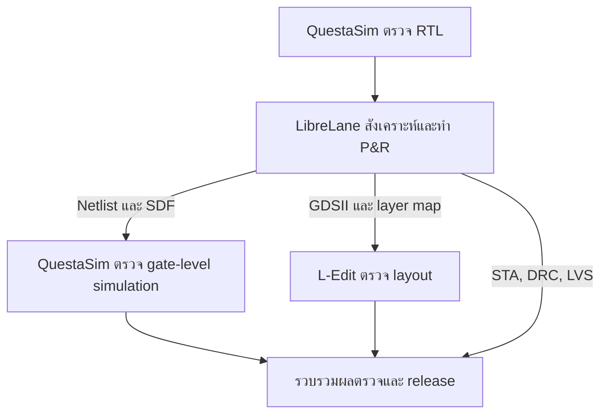

ใช้ **QuestaSim ตรวจ RTL ก่อนเข้า LibreLane** แล้วแยกผลจาก LibreLane เป็นสองทาง คือ **netlist และ SDF กลับไปตรวจใน QuestaSim** และ **GDSII เข้า L-Edit เพื่อตรวจ layout** ตัวอย่างด้านล่างใช้ SystemVerilog FIFO จากชุดฝึกเดิมกับ IHP SG13G2 โดยเริ่มจาก core ก่อนต่อยอดเป็น full chip ที่มี pad ring



| ขั้น | งานที่ทำ | หลักฐานก่อนส่งต่อ |
|---|---|---|
| 1. QuestaSim RTL | รัน `vsim -c -do sim/run_fifo.do` ตรวจ reset, ลำดับข้อมูล, full/empty และ push/pop พร้อมกัน | Transcript มี `PASS` และบันทึก seed กับค่า `D` |
| 2. LibreLane | ตั้ง top เป็น `sync_fifo` ใช้ค่า parameter ตรงกับ RTL regression แล้วรัน synthesis, floorplan, placement, CTS และ routing | ระบุ run tag, PDK revision, clock constraint และผล STA/DRC/LVS |
| 3. QuestaSim GLS | รัน functional GLS ก่อน จากนั้นเพิ่ม SDF สำหรับ timed GLS หากมี timing models และ SDF ที่ตรงกับ netlist | Scoreboard ผ่าน และรายงาน SDF annotation ระบุ instance และ corner ที่ใช้ |
| 4. L-Edit | Import สำเนา GDSII ด้วย layer map ของ L-Edit แล้วตรวจ hierarchy, ขนาด และเลเยอร์เทียบกับ KLayout | Top cell, bounding box, units, layer/datatype และตำแหน่ง pin/label ตรงกับต้นฉบับ |
| 5. Release | รวบรวม RTL revision, GDSII, netlist, constraints และรายงานของ run เดียวกัน | ระบุได้ว่าไฟล์แต่ละชิ้นมาจาก run ใดและตรวจด้วยเครื่องมือรุ่นใด |

LibreLane จัดผลลัพธ์ไว้ใต้ `runs/<run-tag>/final/` โดยมี view เช่น `nl/`, `pnl/`, `gds/`, `sdc/`, `sdf/` และ `spef/` ตามขั้นตอนที่รันและการตั้งค่า ให้เลือก netlist, SDF และ GDSII จาก run เดียวกันเพื่อให้ผลตรวจอ้างถึง design revision เดียวกัน. [LibreLane Documentation](https://librelane.readthedocs.io/en/stable/getting_started/newcomers/index.html?utm_source=chatgpt.com)

**QuestaSim → LibreLane.** ส่งเฉพาะ RTL ที่สังเคราะห์ได้ เช่น `rtl/sync_fifo.sv` เข้า LibreLane ส่วน `tb/tb_fifo.sv` ใช้กับ simulator ถ้า RTL regression ใช้ `D=4` และ `W=8` ให้ยืนยันว่า synthesis ใช้ค่าเดียวกัน แล้วกำหนด clock ที่พอร์ต `clk` พร้อม I/O constraints ตามสมมติฐานของ Lab คาบ 10 ns ใน testbench เป็นคาบของ stimulus ส่วน clock constraint ใน LibreLane เป็นเป้าหมายที่ใช้วิเคราะห์ timing ของ design

**LibreLane → QuestaSim.** เริ่มด้วย functional GLS โดยใช้ mapped netlist และ Verilog simulation models ของ standard cells รวมถึง macro ที่ปรากฏใน netlist ถ้า netlist มีพอร์ตไฟเลี้ยง ให้ต่อผ่าน testbench wrapper ตามชื่อพอร์ตจริง สำหรับ FIFO เดิม ให้คง scoreboard และ stimulus ไว้ แต่ปรับ DUT instantiation ให้ตรงกับพอร์ตของ netlist ซึ่งอาจไม่มี parameter `D` ให้ override แล้ว เพราะ synthesis กำหนดค่าไปแล้ว

เมื่อ functional GLS ผ่าน จึงเพิ่ม SDF โดยระบุ path ของ DUT ใน testbench และเลือก SDF ให้ตรงกับ netlist และ corner ตัวอย่างคำสั่ง โดยต้องเปลี่ยนชื่อไฟล์ตามผลจริงของ run

```tcl
vlib work
vlog -sv <cell_models.v> <mapped_netlist.v> <tb_fifo_gls.sv>

# Functional GLS
vsim work.tb_fifo_gls
run -all

# Timed GLS — โหลด simulation ใหม่ด้วย SDF
vsim -sdfmax /tb_fifo_gls/dut=<matching_corner.sdf> work.tb_fifo_gls
run -all
```

ตรวจรายงาน annotation ก่อนอ่าน waveform โดยเฉพาะ instance ที่หาไม่พบและ timing arc ที่ annotate ไม่ได้ สำหรับ timed GLS ให้กำหนดเวลาที่ scoreboard อ่าน `dout` จาก interface timing ของ Lab การใช้ `#1` จาก RTL testbench ตรง ๆ อาจทำให้ checker อ่านก่อนข้อมูลมาถึง ให้เก็บ STA เป็นหลักฐานสำหรับ setup/hold และใช้ timed GLS ตรวจพฤติกรรมภายใต้ stimulus ที่รัน. [ww1.microchip.com](https://ww1.microchip.com/downloads/aemDocuments/documents/FPGA/swdocs/questasim/questa_sim_user_2024_2.pdf?utm_source=chatgpt.com)

**LibreLane → L-Edit.** เปิด GDSII ต้นฉบับใน KLayout ด้วยเทคโนโลยี IHP SG13G2 เพื่อเก็บค่าอ้างอิง แล้ว import สำเนาใน L-Edit โดยใช้ stream map ที่ตรงกับรูปแบบของ L-Edit ตาราง SG13G2 ใช้ตรวจความหมายของคู่ `layer/datatype` ได้ เช่น Metal1 drawing `8/0` และ Metal1 pin `8/2` แต่ไฟล์ `sg13g2.map` ที่มากับ PDK มีรูปแบบเฉพาะของ flow จึงต้องแปลง mapping ให้ตรงกับ L-Edit ก่อนใช้ ตรวจทั้ง drawing, pin, text label, via และ fill โดยเฉพาะเมื่อขยายไปถึง pad ring. [GitHub](https://github.com/IHP-GmbH/IHP-Open-PDK/blob/main/ihp-sg13g2/libs.tech/klayout/tech/sg13g2.map?utm_source=chatgpt.com)

ถ้าใช้ L-Edit เพื่อตรวจ layout ให้เก็บ GDSII จาก LibreLane เป็นไฟล์ release หากแก้ geometry ใน L-Edit แล้วต้องการนำผลไปผลิต ให้ export เป็น GDSII ฉบับใหม่และรัน DRC/LVS บนไฟล์นั้น หากแก้ routing หรือรูปทรงที่กระทบ parasitics ให้สกัดข้อมูลใหม่และประเมิน timing ซ้ำด้วย

ชุดฝึกเดิมยืนยันผล FIFO ด้วย Icarus Verilog แล้ว ส่วนการรัน QuestaSim และการ import ใน L-Edit ยังต้องยืนยันบนเครื่องอบรมก่อนใช้ flow นี้เป็นเกณฑ์ตรวจรับ Lab ครับ