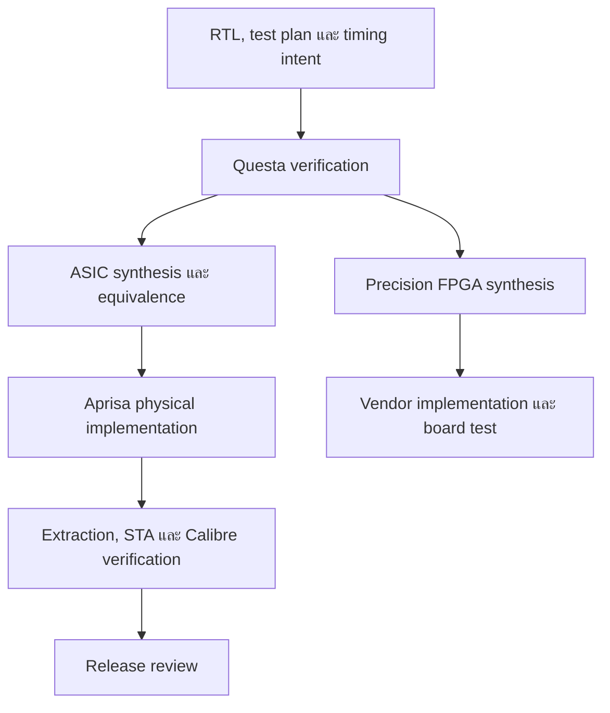

# Siemens Digital Design Toolchain

บทประกอบคู่มือ Advanced Digital IC Design • ASIC standard-cell flow และแขนง FPGA prototyping

## 1. วาง toolchain จากสิ่งที่แต่ละขั้นต้องพิสูจน์

เริ่มจากกำหนดว่าใครเป็นเจ้าของ RTL, timing intent, physical database และ release จากนั้นเลือกเครื่องมือให้ตรงกับหลักฐานที่ต้องใช้ตัดสิน เช่น regression สำหรับ requirement เชิงพฤติกรรม, equivalence สำหรับผลของ synthesis, STA สำหรับ timing และ DRC/LVS สำหรับ layout การเลือกชุดเครื่องมือเดียวกันทั้งโครงการช่วยลดงานแปลงข้อมูล แต่ทุก handoff ยังต้องตรวจชื่อ object, units, mode, corner และ revision

ในบทนี้แบ่ง flow ตามหน้าที่ทางวิศวกรรม ชื่อ **Digital Design Creation Platform** ของ Siemens ครอบคลุมผลิตภัณฑ์อย่าง Catapult, PowerPro, mPower, Precision, Aprisa และ Tessent ส่วน Questa และ Calibre เข้ามารับงาน verification คนละระดับของดีไซน์ การจัดซื้อและการติดตั้งจริงให้ตรวจ feature entitlement, release และ PDK setup ของโครงการ

## 2. แผนที่เครื่องมือและหลักฐานตรวจรับ

| ขั้น | เครื่องมือ Siemens | อินพุต → เอาต์พุต | เกณฑ์ตรวจรับ |
|---|---|---|---|
| RTL simulation | Questa One Sim, QuestaSim หรือ ModelSim ตาม edition | HDL + TB → transcript, waveform, coverage ตามความสามารถ | Top และ binding ถูกต้อง ผล regression ผูกกับ requirement |
| Static RTL verification | Questa Lint, CDC, RDC | RTL + clocks/resets/modes → findings และ path reports | ตรวจ domains ครบและมี disposition ของ violations |
| Property checking | Questa Verify Property ตาม installation | DUT + assertions/assumptions → proof, counterexample, cover | ตรวจ assumptions และ reachability แยก proven, bounded, inconclusive |
| ASIC synthesis | Oasys-RTL หรือ synthesis stage ของ Aprisa flow ที่จัดให้ | RTL + Liberty + SDC [+ physical views] → mapped netlist | Link ได้, mapping ครบ, timing coverage และ QoR ตรวจสอบได้ |
| Equivalence | FormalPro หรือ equivalence flow ที่โครงการรับรอง | Golden RTL + revised netlist + models → compare results | จุดที่ fail, unmatched หรือ aborted มี disposition |
| DFT | Tessent ตาม scan/ATPG/MBIST architecture | Design + test intent → test structures, protocol, patterns, coverage | DFT rule checks, chain integrity และ fault coverage ตามเกณฑ์ |
| Physical implementation | Aprisa | Netlist/RTL ตาม entry point + SDC + PDK → routed layout และ netlist | Placement/routing, PG connectivity และ timing closure ตาม stage |
| RC extraction | Calibre xRC/xACT ตาม deck ที่รับรอง หรือ extractor ของ flow | Layout + extraction rules → parasitics สำหรับ downstream | RC corner, units และ annotation ตรงกับ snapshot |
| Physical verification | Calibre nmDRC และ nmLVS | Stream + rule decks + LVS reference → results | DRC และ LVS ตามเกณฑ์ของโครงการและ waiver ที่อนุมัติ |
| Power และ power integrity | PowerPro และ mPower ตาม analysis setup | Workload/cell models หรือ PDN/current model → power หรือ integrity reports | ระบุ activity, voltage, temperature, supply network และ scenario |
| FPGA prototype | Precision RTL + vendor implementation | RTL + device constraints → FPGA netlist → bitstream | Timing และ I/O assignment ของ target board ผ่านเกณฑ์ |

Catapult เพิ่มเส้นทางจาก algorithm ที่รองรับ เช่น C++/SystemC ไป RTL แล้วส่ง RTL เข้า verification และ implementation gates ตามปกติ สำหรับ SoC ขนาดใหญ่ Veloce เป็นทางเลือกสำหรับ hardware-assisted verification เมื่อ workload เช่น firmware boot เกินความเหมาะสมของ RTL simulation ในแผนทดสอบ

## 3. Front-end — จาก specification ถึง verified RTL

### 3.1 จัด baseline ด้วย Questa หรือ ModelSim

ใช้ acc8 จาก Lab 1 กำหนด synchronous active-low reset, enable และผลบวก modulo 256 ให้ตรวจได้เป็นราย requirement รัน directed tests สำหรับ reset priority, hold, consecutive additions และ wrap จาก 250 + 10 เป็น 4

1. Compile design sources ตาม dependency order ลง logical library แล้ว compile TB
2. Elaborate TB top และตรวจ DUT binding, generics และ language standard จาก transcript
3. รัน assertions และ scoreboard ด้วย sampling ที่สอดคล้องกับ HDL scheduling
4. เก็บ regression log, test/seed และ waveform สำหรับ failure จงใจทำให้ผลผิดหนึ่งกรณีเพื่อยืนยันว่า batch gate คืนสถานะ fail

### 3.2 เพิ่ม static และ formal checks

สร้าง clock/reset inventory ก่อนรัน CDC/RDC ระบุ mode, source/destination, crossing protocol และ reset relation การอ่าน crossing count ต้องเริ่มจากตรวจว่า tool มองเห็น clocks และ instances ครบ เช่น ถ้า clock หลัง mux ยังไม่ถูกประกาศ การสรุปว่าไม่มี unsafe crossings จะขาดหลักฐาน

สำหรับ formal ให้ใช้ requirement เดียวกับ TB แต่กำหนด sampling ให้ถูกต้อง ตัวอย่าง acc8 ที่ sample ก่อน edge ให้ตรวจผลใน sample ถัดไป Assumptions ต้องมาจาก environment contract และใช้ cover ตรวจว่า reset release, addition และ wrap เข้าถึงได้จริง โดยเฉพาะเมื่อ proof ผ่านเร็วผิดคาด

## 4. Synthesis, DFT และ netlist verification

1. เลือก synthesis entry point ของ Oasys-RTL หรือ Aprisa ตามโครงการ กำหนด top, libraries, PVT, allowed cells และ effective SDC ก่อน map หากใช้ physical-aware mode ให้ระบุ LEF และ floorplan assumptions
2. ตรวจ inferred registers, memory/macros และ unresolved instances หลัง mapping ให้ trace Q → adder/control → D ของ acc8 และตรวจว่า reset/enable semantics สอดคล้องกับ RTL
3. ส่ง mapped netlist เข้า equivalence โดยใช้ RTL revision เดียวกับ synthesis เป็น golden ตรวจ model ของ constants, black boxes และ reset หากมี retiming หรือ state re-encoding ให้ใช้วิธีเปรียบเทียบที่รองรับ
4. หากต้องทำ DFT ให้กำหนด test clocks, resets, scan enable, shift/capture modes และ test structures ตั้งแต่ architecture แล้วตรวจ netlist หลัง insertion ทั้ง functional equivalence ใน functional mode และ DFT evidence ใน test modes
5. รัน functional GLS ด้วย cell models ที่ตรงกับ netlist กรณี TB เป็น VHDL และ netlist เป็น Verilog ให้ใช้ wrapper หรือ mixed-language binding ที่ simulator edition รองรับ ตรวจจาก elaboration ว่าโหลด mapped DUT จริง

SDC ของ acc8 ใช้ clock 20 ns, uncertainty setup/hold 0.20/0.10 ns, input min/max 0.30/2.00 ns และ output min/max −0.30/2.00 ns ตรวจว่า constraints ผูก clock 1 เส้น, non-clock inputs 10 บิต และ outputs 8 บิตครบ เปรียบเทียบ max/min report และ unconstrained endpoints ก่อนใช้ WNS/TNS ตัดสิน mapping

## 5. Back-end — Aprisa, extraction, STA และ Calibre

### 5.1 ส่ง netlist ให้ physical implementation

| Handoff item | จุดที่มักผิด | วิธีตรวจ |
|---|---|---|
| Mapped Verilog | Top, macro pin names หรือ PG convention ต่างกัน | Link design และ audit unresolved instances |
| Effective SDC | Hierarchy/port names เปลี่ยน | ตรวจ clock, exception bindings และ I/O coverage |
| Tech/cell/macro LEF | PDK revision, units หรือ routing layers ต่างกัน | ตรวจ site, layer stack, pin access และ macro obstructions |
| UPF หรือ power plan | Domain names และ supply nets ไม่สอดคล้อง | ตรวจ isolation, level shifters, retention และ PG connections |
| PVT/RC matrix | Corner ถูกอ้างด้วยชื่อที่กำกวม | ผูกชื่อ scenario กับไฟล์ Liberty, extraction rules และ mode |

Aprisa ดำเนินงาน floorplan, power planning, placement, CTS และ routing ตาม configuration ที่ใช้ เก็บ checkpoint และ reports แยกแต่ละขั้น หากหลัง placement พบ congestion และ timing แย่ลง ให้ดู cell/net delay และตำแหน่ง macro ก่อนปรับ synthesis effort เพราะคอขวดอาจเกิดจากช่องเดินสายหรือ pin access

### 5.2 แยกหลักฐานจาก timing และ physical verification

- **STA** วิเคราะห์ setup/hold และ checks อื่นตาม mode/PVT/RC ใช้ netlist, Liberty, SDC และ SPEF ที่ตรงกัน หลัง CTS ตรวจ propagated clocks ตาม setup ขั้น pre-layout ใช้เป็น baseline สำหรับ constraints และ logic depth
- **Extraction** เลือก extractor และ rule deck ที่ตรงกับเทคโนโลยี ตรวจชื่อ nets, R/C units, coupling และ annotation coverage ก่อนวิเคราะห์ timing
- **Calibre nmDRC** ตรวจ geometry ตาม deck ของโครงการ เช่น spacing, width และ enclosure ส่วน **nmLVS** เปรียบเทียบ connectivity/devices จาก layout กับ reference ที่เหมาะกับ deck เช่น CDL/SPICE ตาม setup ตรวจ stream top, layer mapping, global nets และ reference revision ก่อนสรุป
- **Timed GLS** ใช้ timing cell models กับ SDF ที่ตรงกับ netlist และ instance scope ตรวจ annotation log และ timing notifier ก่อนวิเคราะห์ X propagation
- **Power integrity** ทวน PDN, supply conditions, current distribution และ scenarios ที่ใช้ตรวจ IR drop/EM แยกจากการประมาณ switching power ด้วย workload

สำหรับ IHP SG13G2 ให้ตรวจว่าห้อง Lab มี technology setup และ deck ที่ใช้กับเครื่องมือนั้นจริง หากใช้ LibreLane/OpenROAD เป็นเส้นทาง implementation ให้ตรวจ entry point และ log ว่าอ่าน mapped netlist ที่ตั้งใจ และยืนยันว่าไม่มี synthesis รอบใหม่ที่เปลี่ยน netlist โดยไม่ตั้งใจ ใช้ qualified deck ตามเกณฑ์โครงการเมื่อจะอ้างผล sign-off

## 6. แขนง FPGA — Precision และการทดสอบบนบอร์ด

เริ่มจาก RTL baseline เดียวกับ ASIC แล้วสร้าง board wrapper, pin constraints และ device target แยก สำหรับ Nexys A7-100T ให้เลือก part/package/speed grade ที่ตรงกับบอร์ดและตรวจว่า Precision release รองรับ จากนั้นส่ง FPGA-mapped netlist ให้ vendor implementation, ตรวจ board I/O กับ timing report แล้วสร้าง bitstream

| รายการ | ASIC | FPGA |
|---|---|---|
| Technology target | Standard cells และ macros ตาม PDK | LUT, carry chains, BRAM, DSP และ device resources |
| Physical constraints | Floorplan, PG, layer stack และ extraction | Pin locations, I/O standards และ device clocks |
| ผลสรุป | Cell area, timing/power และ layout verification | Resource utilization, FPGA timing และ board results |

หาก simulation ผ่านแต่บอร์ดผิด ให้ตรวจ clock/reset และ pin mapping ก่อน จากนั้นตรวจ timing, synchronizers และ protocol ตาม symptom ผลบนบอร์ดช่วยตรวจ integration แต่ข้อสรุป timing/area ของ ASIC ต้องอ้าง ASIC libraries และ reports

## 7. เกณฑ์จบ Lab และ release review

1. **Lab 1** ส่ง Questa/ModelSim baseline พร้อม negative control และ requirement coverage
2. **Lab 2** ส่ง mapped netlist, effective SDC, max/min reports และตัวอย่างคำนวณ slack อย่างละหนึ่ง path
3. **Handoff drill** ลบ output delay ทั้งสองบรรทัดบน SDC สำเนา รัน audit ใน session ใหม่ แล้วชี้ให้เห็นว่า sum_o paths ที่หายไปเกิดจาก constraint coverage
4. **Implementation review** เปรียบเทียบ pre-layout, post-CTS และ post-route โดยแยก clock latency/skew, cell delay และ net delay
5. **Release manifest** เก็บ top, commit, tool versions, PDK/deck revision, scenario definitions, artifact checksums, approved waivers และ owner ต่อผลตรวจ ทุก report ต้องสืบย้อนกลับถึง netlist/layout snapshot ที่ใช้สร้างได้

บทนี้ใช้ flow ของหลักสูตรและข้อมูลผลิตภัณฑ์เป็นฐานสำหรับวางแผน handoff ตัวอย่าง acc8 เชื่อม Labs 1–2 ส่วนการรันแบบ end-to-end ด้วย Siemens tools และ IHP SG13G2 ยังไม่ได้ทดสอบในสภาพแวดล้อมนี้

## อ้างอิง

- [Siemens Digital Design Creation Platform](https://blogs.sw.siemens.com/digital-design-creation-platform/)
- [Questa One Sim](https://www.siemens.com/en-gb/products/ic/questa-one/simulation/questa-one-sim/)
- [Questa Design Solutions](https://www.siemens.com/en-gb/products/ic/questa-one/design-solutions/)
- [Questa Verify Property](https://www.siemens.com/en-us/products/ic/questa-one/formal-verification/verify-property/)
- [FormalPro](https://eda.sw.siemens.com/en-US/eda-cloud-solutions/ic/formalpro-equivalence-checking/)
- [Oasys-RTL](https://resources.sw.siemens.com/en-GB/fact-sheet-oasys-rtl/)
- [Aprisa RTL-to-GDS](https://www.siemens.com/en-gb/products/ic/ic-design/rtl-to-gds/)
- [Calibre Circuit Verification](https://www.siemens.com/en-gb/products/ic/calibre-design/circuit-verification/)
- [Calibre parasitic extraction](https://blogs.sw.siemens.com/calibre/2026/02/17/how-to-use-calibre-parasitic-extraction-tools-step-by-step-guide/)
- [Precision RTL](https://www.siemens.com/en-us/products/ic/precision/rtl/)
