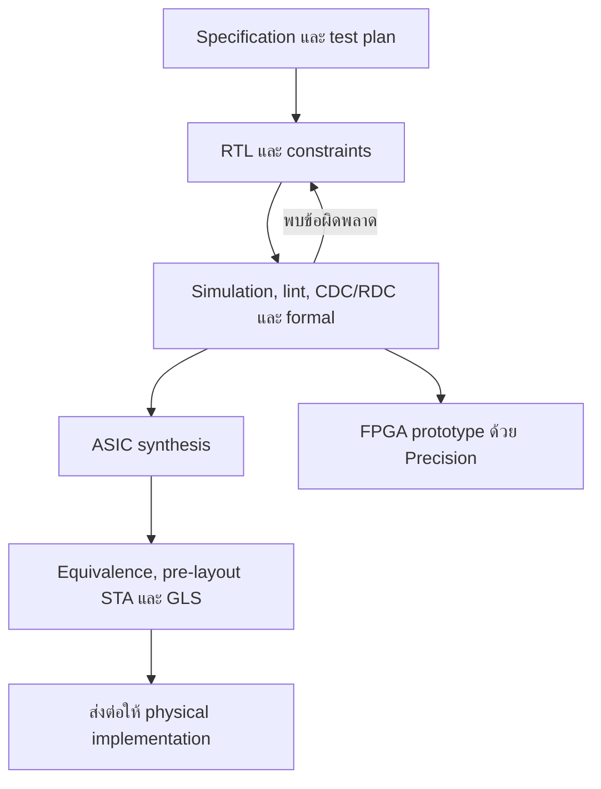

# Siemens EDA Tool Flow for Front-End Digital IC Design

บทประกอบหลักสูตร Advanced Digital IC Design • VHDL-2008, Questa และ ASIC standard-cell flow

## 1. ขอบเขตและเกณฑ์จบงาน

Front-end เริ่มจาก specification ที่ตรวจสอบได้ ผ่าน RTL design, functional verification, static checks, synthesis และการตรวจ mapped netlist แล้วส่งมอบข้อมูลที่ทีม physical implementation ใช้ต่อได้ บทนี้ใช้ Questa/ModelSim ในภาคปฏิบัติและแยกเส้นทาง ASIC กับ FPGA หลัง RTL verification กิจกรรม DFT และ UPF ใช้เมื่อข้อกำหนดโครงการต้องการ ส่วน STA หลัง routing และการตรวจ DRC/LVS อยู่ในขั้น physical sign-off



| ขั้น | เครื่องมือ | หลักฐานที่ต้องเก็บ |
|---|---|---|
| วิเคราะห์และจำลอง RTL | Questa One Sim, QuestaSim หรือ ModelSim ตาม edition | Compile manifest, transcript, test/seed, waveform สำหรับ debug |
| วิเคราะห์เชิงโครงสร้าง | Questa Lint, Questa CDC, Questa RDC | Clock/reset inventory, violations, waivers ที่มีผู้ทบทวน |
| ตรวจ properties | Questa formal apps ตาม license | Properties, assumptions, cover traces, proof status |
| สังเคราะห์ ASIC | Oasys-RTL หรือ synthesis flow ที่ห้องปฏิบัติการจัดให้กับ Aprisa | Standard-cell netlist, SDC สำหรับ netlist, timing/area reports |
| สังเคราะห์ FPGA | Precision RTL → vendor implementation | FPGA netlist, LUT/FF/BRAM/DSP, device constraints |
| ตรวจ RTL เทียบ mapped netlist | FormalPro หรือ equivalence flow ที่โครงการรับรอง | Compare points, equivalence results, modeling assumptions |
| ตรวจ manufacturing test | Tessent ตาม DFT architecture | Scan netlist, scan protocol, DFT DRC, ATPG coverage ตามขอบเขต |
| วิเคราะห์กำลังไฟ | PowerPro ตาม setup | Workload, activity coverage, library/corner และรายงานกำลังไฟ |

ตรวจ release, edition, licenses และ platform ที่ห้องปฏิบัติการรองรับก่อนจัด Lab คำสั่ง compile และ simulation ด้านล่างเป็นตัวอย่าง CLI สำหรับสาย Questa/ModelSim ส่วนการตั้งค่า CDC, formal, synthesis และ DFT อธิบายเป็นขั้นตอนที่ใช้สร้าง flow ตาม reference scripts ของรุ่นที่ติดตั้ง

## 2. Specification → microarchitecture → RTL

กำหนด clock/reset, transfer condition, latency, throughput, signedness, overflow, register map และพฤติกรรมระหว่าง reset ก่อนสร้าง RTL แยก cycle ที่ข้อมูลถูกยอมรับออกจาก cycle ที่ output ใช้งานได้ โดยระบุว่าจะสังเกตสัญญาณก่อนหรือหลัง edge ใน testbench ให้ชัดเจน ถ้ามี backpressure ให้กำหนดผู้มีหน้าที่รักษา data และ valid เมื่อ ready เป็น 0

ตัวอย่างประจำบทเป็น accumulator 8 บิต ใช้ rising edge, synchronous active-low reset และ enable ข้อมูลเป็น unsigned ผลบวก wrap modulo 256, reset มี priority สูงกว่า enable, output แสดงค่าใหม่หลัง edge ที่รับข้อมูล อินพุตเปลี่ยนที่ falling edge ใน Lab เพื่อให้แยกการ drive ออกจาก sampling

| Requirement | พฤติกรรม | หลักฐาน |
|---|---|---|
| ACC-01 | Reset ล้างค่าแม้ enable เป็น 1 | Reset ขณะผลสะสมเดิมมีค่าที่ไม่เป็นศูนย์ |
| ACC-02 | Enable เป็น 0 แล้วคงค่า | เปลี่ยน input ขณะ disable และเปรียบเทียบ output |
| ACC-03 | Enable เป็น 1 แล้วบวกทุก edge | ป้อนหลาย transaction ต่อเนื่อง |
| ACC-04 | ผลบวกเกิน 255 แล้ว wrap | 250 + 10 ได้ 4 |

จัด source manifest ให้ระบุไฟล์ตาม compile order, logical libraries, VHDL standard, top-level, generics, Verilog macros และ include paths ใช้ configuration เดียวกันระหว่าง simulation กับ synthesis ในส่วนที่กำหนดฮาร์ดแวร์จริง VHDL ควรใช้ numeric_std, ระบุ width conversion ชัดเจน และกำหนด output ครบทุก branch ใน combinational process สังเคราะห์เฉพาะ design sources แยกจาก TB และ behavioral models

## 3. Lab 1 — RTL simulation ด้วย Questa หรือ ModelSim

สร้าง `acc8.vhd`

```vhdl
library ieee;
use ieee.std_logic_1164.all;
use ieee.numeric_std.all;

entity acc8 is
  port (
    clk_i, rst_ni, en_i : in std_logic;
    data_i              : in std_logic_vector(7 downto 0);
    sum_o               : out std_logic_vector(7 downto 0)
  );
end entity;

architecture rtl of acc8 is
  signal sum_q : unsigned(7 downto 0);
begin
  process (clk_i)
  begin
    if rising_edge(clk_i) then
      if rst_ni = '0' then
        sum_q <= (others => '0');
      elsif en_i = '1' then
        sum_q <= sum_q + unsigned(data_i);
      end if;
    end if;
  end process;
  sum_o <= std_logic_vector(sum_q);
end architecture;
```

สร้าง `tb_acc8.vhd`

```vhdl
library ieee;
use ieee.std_logic_1164.all;
use ieee.numeric_std.all;

entity tb_acc8 is
end entity;

architecture test of tb_acc8 is
  signal clk : std_logic := '0';
  signal rst_n, en : std_logic := '0';
  signal din : std_logic_vector(7 downto 0) := (others => '0');
  signal dout : std_logic_vector(7 downto 0);
begin
  clk <= not clk after 10 ns;
  dut : entity work.acc8
    port map (clk_i => clk, rst_ni => rst_n, en_i => en,
              data_i => din, sum_o => dout);

  stimulus : process
    procedure step(rst, enable : std_logic;
                   value, expected : natural; label_text : string) is
    begin
      wait until falling_edge(clk);
      rst_n <= rst;
      en <= enable;
      din <= std_logic_vector(to_unsigned(value, din'length));
      wait until rising_edge(clk);
      wait for 1 ns;
      assert dout = std_logic_vector(to_unsigned(expected, dout'length))
        report label_text & " failed" severity failure;
    end procedure;
  begin
    step('0', '1',  17,   0, "ACC-01 initial reset");
    step('1', '1', 250, 250, "ACC-03 first addition");
    step('1', '1',  10,   4, "ACC-04 wrap");
    step('1', '0',  99,   4, "ACC-02 hold");
    step('1', '1',   2,   6, "ACC-03 resume");
    step('0', '1',   7,   0, "ACC-01 reset priority");
    report "TB_ACC8_PASS" severity note;
    wait;
  end process;
end architecture;
```

รันจากไดเรกทอรีใหม่ที่มีไฟล์ทั้งสอง

```bash
set -euo pipefail
vlib work
vmap work work
vcom -2008 -work work acc8.vhd tb_acc8.vhd
vsim -c -t 1ps work.tb_acc8 -do 'run 150 ns; quit -f' 2>&1 | tee rtl.log
rg -q 'TB_ACC8_PASS' rtl.log
if rg -q '\*\* (Failure|Fatal|Error):' rtl.log; then
  exit 1
fi
```

ตัวทดสอบใช้เวลา 131 ns จึงรัน 150 ns และตรวจทั้ง PASS marker กับข้อความ error เพราะ simulator exit code อย่างเดียวอาจขึ้นกับการตั้งค่า break และ batch script ทดสอบเส้นทาง failure ด้วยการเปลี่ยน expected 4 เป็น 5 ในการทดสอบ wrap แล้วตรวจให้ shell คืนสถานะล้มเหลว การหน่วง 1 ns เป็นจุด sample ของ RTL testbench เพื่อรอ signal updates ใน delta cycles เมื่อปรับไปใช้ timed GLS ต้องกำหนดจุด sample ตามเวลาที่วงจรและ interface ต้องรับประกัน

เมื่อขยายเป็น SoC ให้แยก driver, monitor, reference model, scoreboard และ assertions เก็บ test name, seed, commit, tool version และ compile options ทุก run ใช้ functional coverage ผูกกับ requirement เช่น reset × enable และ wrap event ตรวจ code coverage เพื่อหา branch ที่ยังไม่ถูกทดสอบ ทบทวน coverage exclusions และ merge เฉพาะฐานข้อมูลที่สร้างจาก configuration ที่เข้ากันได้

## 4. Lint, CDC/RDC และ formal

**Lint** ตั้ง top และ rule deck ให้ตรงกับ elaborated design แยกกลุ่ม width truncation, unintended latch, undriven/multiple-driven nets, incomplete cases และ combinational feedback สำหรับตัวอย่างนี้ wrap เป็นเจตนาของ spec จึงบันทึกเหตุผลได้ การตัดบิตที่กระทบการตีความ signed หรือ carry ต้องกลับไปแก้ RTL หรือ spec ทำ baseline ตาม rule ID และ instance เพื่อให้ regression จับ warning ใหม่ได้

**CDC** สร้างตาราง source clock, destination clock, clock relation, crossing width, protocol และ expected synchronizer ระบุ generated clock และ clock mux modes ก่อนวิเคราะห์ Crossing แบบ level 1 บิตที่ค้างนานพอใช้ synchronizer 2 FF ตาม MTBF และข้อกำหนดเทคโนโลยี พัลส์ที่สั้นกว่าคาบปลายทางอาจหายได้ ใช้ handshake, toggle ที่มีข้อจำกัดอัตรา event หรือ asynchronous FIFO ตาม throughput หลีกเลี่ยงการ sync data bus ทีละบิต เพราะบิตอาจมาถึงคนละรอบ ตรวจ reconvergence ของสัญญาณควบคุมและข้อมูล รวมทั้ง constraints ที่รักษาคุณสมบัติของ Gray pointer บน implementation

**RDC** ตรวจ crossing ระหว่าง reset domains แม้ใช้ clock เดียวกัน เช่น flop A ถูก asynchronous reset ขณะ flop B ยังทำงานและ sample ค่า A สำหรับระบบที่ใช้ asynchronous assertion ให้ตรวจ synchronous deassertion ในแต่ละ domain และลำดับ release ตาม IP contract ทบทวนเส้นทาง isolation, reset sequencing หรือ handshake ตามชนิด crossing การกำหนด false path มีผลต่อ STA ส่วนความถูกต้องของ protocol ต้องมีหลักฐานแยกต่างหาก

**Formal property checking** แปลง ACC-01 ถึง ACC-04 เป็น assertions โดยกำหนดจุด sample ให้สัมพันธ์กับ edge และค่า state หลัง update ตัวอย่าง property คือ หาก enable เป็น 0 และ reset inactive ที่ edge ก่อนหน้า ค่า accumulator ณ edge ปัจจุบันต้องเท่า state ณ edge ก่อนหน้า ภายใต้การ sample แบบ pre-edge ใช้ cover เพื่อยืนยันว่า reset release, enable และ wrap สามารถเกิดได้จริง Assumptions ต้องอธิบายข้อจำกัดของ environment เช่น reset protocol แยก proven, failed, bounded และ inconclusive ทดสอบ assumption ที่เข้มเกินด้วย cover เช่น assumption ที่ตรึง enable เป็น 0 จะทำให้ property สำหรับการบวกผ่านแบบ vacuous

waiver ที่ตรวจสอบย้อนกลับได้ควรมี rule, instance/crossing, เหตุผล, หลักฐาน, owner และเงื่อนไขที่ต้องตรวจซ้ำ เช่น เปลี่ยน clock relation, reset topology หรือ IP version

## 5. Lab 2 — ASIC synthesis และ pre-layout timing

### 5.1 เตรียมข้อมูลเทคโนโลยี

| View | ใช้ที่ขั้นใด | ตรวจอะไร |
|---|---|---|
| Liberty | Mapping และ STA | Cell names, functions, PVT, units, timing arcs, constraints |
| Verilog cell models | GLS และ modeling ตาม equivalence setup | Pin names, power-pin variant, functional/timing model |
| Tech LEF และ cell/macro LEF | Physical-aware synthesis หรือ P&R | Site, routing layers, cell/macro size และ pin access |
| GDS/OASIS และ LVS views | Physical release และ verification | เซลล์ตรงกับ library revision ที่ใช้จริง |
| Macro views | Synthesis, STA และ P&R | Black-box ports, Liberty/LEF และ behavior ของ SRAM/IP |

สำหรับ IHP SG13G2 ให้บันทึก PDK revision, library subset, allowed/dont-use cells และ paths ที่ใช้จริง ตรวจความเข้ากันได้ด้วย smoke design ก่อนใช้ทั้ง SoC การมี open PDK views ครบเป็นเพียงส่วนหนึ่งของการ qualification เครื่องมือ ทีมต้องตรวจ parser, library linking, cell mapping, units, timing model และ physical technology setup ตาม flow ที่ใช้งาน

### 5.2 สร้าง SDC จาก interface budget

ตัวอย่างใช้หน่วย ns โดยต้องตรวจ time unit ที่ tool session ใช้ กำหนด input/output delays เทียบกับ clock เดียวกันสำหรับโมเดลที่ external launch/capture ใช้ clock นี้ ค่า output min ติดลบเป็นตัวอย่าง budget ที่สะท้อน external hold requirement เมื่อสมมติ board skew/delay เป็นศูนย์ ค่าใช้งานจริงต้องคำนวณจาก external setup/hold, launch delay, clock skew และ board delays

```tcl
create_clock -name core_clk -period 20.0 [get_ports clk_i]
set_clock_uncertainty -setup 0.20 [get_clocks core_clk]
set_clock_uncertainty -hold  0.10 [get_clocks core_clk]

set inputs [get_ports {rst_ni en_i data_i*}]
set_input_delay  -clock core_clk -max 2.00 $inputs
set_input_delay  -clock core_clk -min 0.30 $inputs
set_output_delay -clock core_clk -max 2.00 [get_ports sum_o*]
set_output_delay -clock core_clk -min -0.30 [get_ports sum_o*]
```

ตรวจว่า port collections ครบ 10 input bits และ 8 output bits ตามรูปแบบที่ STA engine แสดง ตรวจหน่วยและชื่อ bus หลัง export ตั้ง input transition หรือ driving cell และ output load จาก environment จริง สำหรับ reset ใน Lab เป็น synchronous control จึงอยู่ใน input timing budget ในระบบหลาย clock ให้สร้าง generated clocks และอธิบาย asynchronous groups ทีละคู่ Exceptions เช่น multicycle ต้องมี functional justification และตรวจ setup/hold edge pairing ใน timing report

### 5.3 รันและตรวจ synthesis

1. โหลด Liberty และกำหนด library/corner ที่ใช้ optimize ระบุ macro black boxes และ cell exclusions
2. อ่าน RTL ตาม manifest, elaborate top `acc8` แล้วตรวจ unresolved instances, parameter widths และ inferred registers
3. อ่าน SDC และตรวจ clock/port object bindings แยก clock coverage, unconstrained endpoints และ exceptions ที่ match ศูนย์ object
4. รัน mapping/optimization หากใช้ physical-aware mode ให้เตรียม physical views และ floorplan assumptions
5. เก็บ mapped netlist, exported constraints, hierarchy/cell usage, area, timing, warnings และ synthesis provenance ตรวจว่าไม่มี generic unmapped cells หรือ black boxes ที่ไม่ได้อนุมัติ
6. รัน pre-layout STA ทั้ง max และ min พร้อมบันทึก corner, estimated interconnect model, WNS/TNS และ unconstrained paths แยกรายงาน input-to-register, register-to-register และ register-to-output

ตัวอย่าง reg-to-reg setup ใช้ period 20 ns, uncertainty 0.20 ns, setup 0.15 ns, data arrival 5.90 ns เมื่อ clock latency เป็นศูนย์ required = 19.65 ns และ slack = 13.75 ns ส่วน hold ใช้ arrival เร็วสุด 0.24 ns, hold 0.10 ns, uncertainty 0.10 ns จึงได้ required = 0.20 ns และ slack = 0.04 ns ทั้งหมดเป็นตัวเลขสาธิต Pre-layout hold margin ขึ้นกับ clock และ interconnect ที่ยังเป็นแบบประมาณ ให้บันทึกเงื่อนไขแล้วตรวจใหม่หลัง CTS และ routing

ทดลองเปลี่ยน period จาก 20 เป็น 10 ns โดยตรึง library, I/O budget และ effort เปรียบเทียบ critical path, WNS, TNS, cell area และ cell count หากต้อง pipeline ให้ทบทวน latency contract และ scoreboard ก่อนเทียบ QoR ทดลองอีกครั้งโดยลบ output delay แล้วดูว่ารายงาน coverage/constraint audit พบ output endpoints ที่ขาด budget หรือไม่

## 6. Netlist verification, DFT และ low power

**Equivalence** ตั้ง golden เป็น RTL revision เดียวกับที่ synthesize และ revised เป็น mapped netlist โหลด cell functions และ IP abstractions ให้สอดคล้องกัน ตรวจ matched, unmatched, failing และ aborted compare points ทบทวน reset assumptions, initial state, undriven/X modeling และ scan/test mode สำหรับ retiming หรือ clock gating ใช้ methodology ที่รองรับ transformation นั้น เก็บ counterexample และบันทึก black-box boundaries โดยเฉพาะ RAM และ encrypted IP

**Functional GLS** compile standard-cell models และ mapped netlist ลง simulator libraries แยกจาก RTL เพื่อหลีกเลี่ยง binding ผิดตัว หาก VHDL TB ใช้ direct entity instantiation เช่น Lab 1 ให้ทำ wrapper/binding สำหรับ mixed language หรือใช้ TB ที่ตรงกับภาษาของ netlist ตั้ง test enables และ power pins ตาม netlist variant รัน smoke reset, interface transactions และ X checks ให้ครบ

**Timed GLS** เพิ่ม SDF ที่มาจาก netlist revision และ corner เดียวกัน ตรวจ hierarchy ของ annotation ที่ DUT และตรวจจำนวน annotated instances/arcs, rejected entries, timescale และ timing-check messages แยก min/max scenario ตามวัตถุประสงค์ Failure หลัง annotate อาจมาจาก testbench race, setup/hold notifier, hierarchy mismatch หรือ reset sequence จึงต้องอ่าน annotation log ควบคู่กับ waveform ใช้ STA สำหรับตรวจเส้นทางที่กำหนดทั้งหมด และใช้ GLS เพื่อยืนยันพฤติกรรมของ scenario ที่กระตุ้นจริง

**DFT** กำหนด scan enable, test clocks, resets, chain partitions และ memory test ตั้งแต่ microarchitecture หลัง insertion ตรวจ DFT rules, chain continuity, functional equivalence ใน functional mode และ timing ของ shift/capture modes เก็บ ATPG fault model, detected/untestable/aborted counts, test coverage ตามนิยามของรายงาน รวมทั้ง patterns และ test protocol ที่สัมพันธ์กับ scan netlist

**UPF และกำลังไฟ** กำหนด supply sets, power domains, power states, isolation, retention และ level shifting ตาม power architecture ใช้ power-aware simulation เพื่อทดสอบ shutdown/restore รวมถึง isolation ก่อน power-off และ release เมื่อ output valid ตรวจ structural implementation ของ intent ใน netlist สำหรับ power analysis ใช้ workload ที่ระบุช่วงเวลาและ mapping coverage ของ activity แยก dynamic switching/internal/leakage และรายงาน PVT กับ voltage/frequency ทุกครั้ง

## 7. ส่งมอบให้ทีม physical implementation

| หมวด | ข้อมูลส่งมอบ | เงื่อนไขตรวจรับ |
|---|---|---|
| Design identity | Commit, manifest, top, generics, tool versions, build scripts | สร้าง design configuration เดิมซ้ำได้ |
| Logical implementation | Mapped netlist, scan variant, macro models, PG pin convention | Cell/macro names ตรงกับ technology views |
| Timing intent | SDC ต่อ mode, clock/reset inventory, corner mapping, exceptions | Collections match ครบและ coverage audit ผ่านตามเกณฑ์ |
| Verification | Regression, coverage, CDC/RDC, formal และ GLS ที่กำหนด | Open items มี owner และเงื่อนไขปิดชัดเจน |
| Physical assumptions | Area, floorplan/macro constraints, pin assumptions, power intent | ทีม back-end ยืนยัน assumptions และ timing budgets |
| Reproducibility | Log, version/hash ของ inputs และ checksums ของ artifacts | Netlist, SDC และ reports มาจาก release เดียวกัน |

เลือก Aprisa หรือ LibreLane/OpenROAD เป็น physical implementation route ตาม setup หากนำ external mapped netlist เข้า LibreLane ให้เลือก flow/entry point ที่รองรับใน release ที่ติดตั้ง ตรวจว่า stage แรกอ่าน netlist และ SDC ที่ตั้งใจ และยืนยันจาก log ว่าไม่มี synthesis รอบใหม่ ตรวจ naming, constant/tie cells, macro LEF/Liberty/GDS และ power connections ก่อน floorplan สำหรับเส้นทาง FPGA บน Nexys A7 ใช้ Precision กับ target ที่รองรับและส่งต่อให้ vendor implementation พร้อม board constraints ตรวจ FPGA timing และ I/O แยกจาก ASIC timing budget

## 8. แบบฝึกทบทวน

1. เปลี่ยน reset ให้ priority ต่ำกว่า enable แล้วระบุ requirement และหลักฐาน regression ที่จะจับ defect นี้
2. เพิ่ม event input จาก clock domain อื่น อธิบายว่าจะเลือก pulse handshake หรือ FIFO จากอัตรา event และ backpressure อย่างไร
3. อธิบายเหตุใด simulation pass และ WNS เป็นบวกจึงยังต้องตรวจ output delay coverage
4. เมื่อ GLS ไม่ผ่านเฉพาะหลัง SDF annotation ให้จัดลำดับการตรวจ hierarchy, timescale, annotation status และ waveform
5. เมื่อ formal รายงาน unmatched compare points หลัง scan insertion ให้ตรวจ functional mode constraints, scan muxes และ cell models ก่อนพิจารณา waiver

## เอกสารอ้างอิง

- [Siemens Questa One Sim](https://resources.sw.siemens.com/ro-RO/fact-sheet-questa-one-sim/)
- [Siemens Questa Design Solutions](https://www.siemens.com/en-gb/products/ic/questa-one/design-solutions/)
- [Siemens Questa Formal Verification](https://eda.sw.siemens.com/en-US/ic/questa/formal-verification/)
- [Siemens Oasys-RTL](https://resources.sw.siemens.com/en-GB/fact-sheet-oasys-rtl/)
- [Siemens Precision RTL](https://www.siemens.com/en-us/products/ic/precision/rtl/)
- [Siemens FormalPro](https://eda.sw.siemens.com/en-US/eda-cloud-solutions/ic/formalpro-equivalence-checking/)
- [Siemens Digital Design Creation Platform](https://blogs.sw.siemens.com/digital-design-creation-platform/digital-design-creation-platform/)

สถานะตัวอย่าง Lab ตรวจความสอดคล้องของ RTL, expected values และ timing arithmetic จากโค้ดและสมการ สภาพแวดล้อมที่จัดทำบทนี้ไม่มี Questa/ModelSim สำหรับรันคำสั่งจริง
