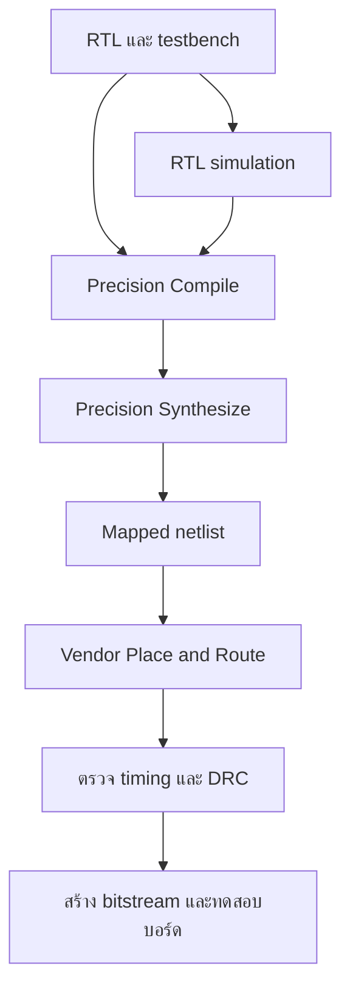

# Siemens Precision Synthesis Quick Start Guide
## คู่มือปฏิบัติฉบับเต็มสำหรับ FPGA

คู่มือนี้ขยายขั้นตอนจาก **Mentor Graphics Precision Synthesis Quick Start Guide, PS2018.1** ที่แนบมา โดยใช้ Lab ออกแบบวงจรไฟกะพริบบน **Digilent Nexys A7-100T** เป็นตัวอย่าง ตั้งแต่ตรวจ RTL ด้วย QuestaSim/ModelSim ไปจนถึงส่ง mapped netlist ให้ AMD Vivado ทำ Place & Route และตรวจ timing หลังเดินสาย

**ผลลัพธ์ของ Lab** คือ simulation transcript, synthesis netlist, รายงานทรัพยากรและ timing ก่อนและหลัง routing และหลักฐานการทดสอบบนบอร์ด ผู้เรียนควรอธิบายได้ว่า constraint ใดมีผลกับ path ใด และย้อนจาก critical path ไปหา RTL ต้นเหตุได้

## 1. ภาพรวมและเส้นแบ่งของแต่ละเครื่องมือ

| ช่วงงาน | อินพุตหลัก | เอาต์พุตที่ใช้ตรวจงาน |
|---|---|---|
| RTL simulation | RTL และ testbench | Transcript, waveform, ผล self-check |
| Precision Compile | RTL, top, library, generic, source order | Compile log, elaborated hierarchy, RTL schematic |
| Precision Synthesize | Elaborated design, FPGA part, timing constraints | Mapped netlist, technology schematic, timing และ utilization |
| Vendor implementation | Mapped netlist, IP netlists ตามที่ใช้, physical/timing constraints | Placed/routed checkpoint, timing, utilization, DRC |
| FPGA programming | Bitstream และบอร์ดตรงกับ part | Hardware smoke test |

Precision RTL ใช้สังเคราะห์ลงทรัพยากร FPGA เช่น LUT, FF, carry chain, DSP และ RAM การเลือก family, device, package และ speed grade จึงเป็นส่วนหนึ่งของการตั้งค่า synthesis คู่มือนี้ใช้ FPGA prototype เป็นงานเป้าหมาย หากนำ RTL ไปผลิต ASIC ให้เริ่ม synthesis สำหรับ ASIC ใหม่ด้วย standard-cell Liberty และ timing constraints ของ ASIC เป้าหมาย



## 2. เตรียมเครื่องมือและ workspace

1. เปิด Precision ผ่าน launcher ของ release ที่ติดตั้ง บันทึก version, edition และ platform จากหน้าต่าง About หรือ startup transcript
2. หาก license checkout ล้มเหลว ให้อ่าน feature ที่เครื่องมือร้องขอ ตรวจค่าที่ผู้ดูแล license ระบุและการเข้าถึง server จากเครื่องที่ใช้งานจริง หากใช้ WSL ให้ตรวจว่า environment ที่เปิดซอฟต์แวร์มองเห็น license และไฟล์โครงการ ใช้ host OS ที่ release รองรับ
3. เปิดรายการ device ใน Precision และตรวจว่ามี AMD/Xilinx Artix-7, XC7A100T, CSG324 และ speed grade −1 ครบ ตรวจ AMD Vivado ว่าติดตั้ง Artix-7 device support แล้ว รหัส part ฝั่ง Vivado คือ `xc7a100tcsg324-1`
4. หากจะเรียก vendor tools ผ่าน GUI ของ Precision ให้ตรวจคู่เวอร์ชันที่ release รองรับและ path ของ vendor executable จากเอกสารที่มากับ installation ตัวอย่างเมนูจาก PDF เป็นหน้าจอ PS2018.1 ชื่อเมนูและ vendor handoff ขึ้นกับ release
5. แยกไฟล์ต้นฉบับและผลรัน โดยสร้างโครงสร้างด้านล่าง ไฟล์ตัวอย่างอยู่ในคู่มือนี้ ให้บันทึกแต่ละบล็อกตามชื่อที่ระบุ

```text
precision_quickstart/
  rtl/blink_top.vhd
  sim/tb_blink_top.vhd
  constraints/blink.sdc
  constraints/blink_board.xdc
  impl/run_vivado.tcl
  runs/
```

## 3. Lab A — สร้างและตรวจ RTL

วงจรใช้ clock 100 MHz ตัวเดียว ปุ่มกลาง active-high ถูก sample ผ่าน flip-flop สองขั้น แล้วใช้เป็น synchronous reset ของ counter และ LED เมื่อ counter ครบ 50,000,000 cycles จะสลับ LED หนึ่งครั้งใน 0.5 วินาที จึงกะพริบครบรอบทุก 1 วินาที การ reset ระหว่างทดสอบใช้การกดปุ่มค้างสั้น ๆ การใช้งานปุ่มเป็น event แบบ one-pulse ต้องออกแบบ debounce และ edge detection เพิ่ม ตัวอย่างนี้ใช้ปุ่มเป็นระดับ reset

### rtl/blink_top.vhd

```vhdl
library ieee;
use ieee.std_logic_1164.all;

entity blink_top is
    generic (HALF_PERIOD_CYCLES : positive := 50_000_000);
    port (
        clk100mhz : in  std_logic;
        btnc      : in  std_logic;
        led0      : out std_logic
    );
end entity;

architecture rtl of blink_top is
    signal rst_meta : std_logic;
    signal rst_sync : std_logic;
    signal count    : natural range 0 to HALF_PERIOD_CYCLES - 1;
    signal led_q    : std_logic;
begin
    process (clk100mhz)
    begin
        if rising_edge(clk100mhz) then
            rst_meta <= btnc;
            rst_sync <= rst_meta;

            if rst_sync = '1' then
                count <= 0;
                led_q <= '0';
            elsif count = HALF_PERIOD_CYCLES - 1 then
                count <= 0;
                led_q <= not led_q;
            else
                count <= count + 1;
            end if;
        end if;
    end process;

    led0 <= led_q;
end architecture;
```

### sim/tb_blink_top.vhd

```vhdl
library ieee;
use ieee.std_logic_1164.all;

entity tb_blink_top is
end entity;

architecture test of tb_blink_top is
    signal clk  : std_logic := '0';
    signal btnc : std_logic := '1';
    signal led0 : std_logic;
    signal done : boolean := false;
begin
    clk <= not clk after 5 ns when not done else '0';

    dut : entity work.blink_top
        generic map (HALF_PERIOD_CYCLES => 4)
        port map (clk100mhz => clk, btnc => btnc, led0 => led0);

    stimulus : process
    begin
        wait for 1 us;
        assert done report "Simulation timeout" severity failure;
        wait;
    end process;

    checks : process
        procedure expect_led(expected : std_logic) is
        begin
            wait until rising_edge(clk);
            wait for 1 ns;
            assert led0 = expected
                report "Unexpected LED value" severity failure;
        end procedure;
    begin
        wait for 30 ns;
        expect_led('0');
        wait until falling_edge(clk);
        btnc <= '0';
        -- Two edges to propagate release, then count four active edges.
        for cycle in 1 to 5 loop
            expect_led('0');
        end loop;
        expect_led('1');
        for cycle in 1 to 3 loop
            expect_led('1');
        end loop;
        expect_led('0');
        for cycle in 1 to 3 loop
            expect_led('0');
        end loop;
        expect_led('1');

        wait until falling_edge(clk);
        btnc <= '1';
        expect_led('1');
        expect_led('1');
        expect_led('0');
        report "PASS: divider, periodic toggle and reset";
        done <= true;
        wait;
    end process;
end architecture;
```

เปิด shell ที่โฟลเดอร์ Lab และใช้ QuestaSim/ModelSim ที่มี license

```bash
vlib work
vcom -2008 rtl/blink_top.vhd sim/tb_blink_top.vhd
vsim -c work.tb_blink_top -do 'onerror {quit -code 1}; set BreakOnAssertion 3; onbreak {quit -code 1}; run -all; quit -code 0'
```

ตรวจข้อความ `PASS: divider, periodic toggle and reset` พร้อมตรวจว่าไม่มี assertion failure หากเปิด GUI ให้เพิ่ม `clk`, `btnc`, `led0`, `rst_meta`, `rst_sync`, `count` ลง waveform ค่าของ counter ใน testbench คือ 0–3 ส่วน synthesis สำหรับบอร์ดใช้ค่า default 50,000,000 cycles

## 4. Lab B — ตั้งโปรเจกต์ใน Precision

### 4.1 สร้าง project และ implementation

1. เลือก **New Project** ตั้งชื่อ `precision_blink` และเลือก directory ที่เขียนได้
2. สร้าง implementation ชื่อ `baseline_100mhz` ตาม workflow ของ release เก็บงานทดลอง timing ใน implementation อื่นหรือใช้ project copy เพื่อให้เปิดรายงานเดิมเทียบได้
3. ใช้ **Add Input Files** เพิ่มเฉพาะ `rtl/blink_top.vhd` และ `constraints/blink.sdc` ในรายการ synthesis เลือกชนิด VHDL และ constraint ให้ตรงกับไฟล์
4. ตั้ง top เป็น `blink_top` โดยใช้ library ที่โปรเจกต์กำหนด เช่น `work` หากทำกับโปรเจกต์จริง ให้เรียง package declarations และ dependencies ก่อน units ที่อ้างถึง เพิ่ม vendor IP ตามการรองรับของ release PDF ระบุชนิดอินพุต VHDL, Verilog, EDIF และ SDC ส่วนมาตรฐานย่อยของภาษาควรตรวจจาก release ที่ใช้
5. เลือก **Setup Design** แล้วตั้ง technology, device, package, speed grade ตามข้อ 2 ตรวจค่า top generic ว่ายังเป็น 50,000,000

### 4.2 กำหนดความถี่และตรวจ clock

ไฟล์ `constraints/blink.sdc`

```tcl
create_clock -name sys_clk -period 10.000 [get_ports {clk100mhz}]
```

ใน PDF มีช่อง **Set Frequency** เป็นอีกจุดสำหรับตั้ง design goal ใช้ 100 MHz หากเลือกทำ Lab แบบกำหนดด้วย GUI ให้ตรวจรายงานหลัง compile ว่า clock ที่ต้องการปรากฏจริง สำหรับการทำซ้ำให้เก็บ SDC ไว้กับ RTL และหลีกเลี่ยงการประกาศ clock ซ้ำจากหลายไฟล์หรือการตั้ง goal ที่ขัดกับ SDC

| ความถี่ | คาบ |
|---:|---:|
| 50 MHz | 20 ns |
| 100 MHz | 10 ns |
| 125 MHz | 8 ns |
| 200 MHz | 5 ns |

Clock report ควรแสดง `sys_clk` บน `clk100mhz`, period 10 ns และ register ที่ถูก clock ครอบคลุม หาก get_ports จับไม่ได้ ให้ตรวจ spelling, top และเวลาที่เครื่องมือ apply SDC จาก transcript

สำหรับ Lab นี้ `btnc` เป็น asynchronous input และ `led0` เป็น output สำหรับมนุษย์สังเกต จึงไม่มี external synchronous I/O budget ให้บันทึกสอง interface นี้ไว้เมื่ออ่านรายงาน unconstrained paths เส้นทางภายในจาก synchronizer stage แรกไป stage ที่สองและจาก stage ที่สองไป reset logic อยู่ในโดเมน 100 MHz เดียวกัน ตรวจว่าเครื่องมือเก็บ flip-flop ของ synchronizer ทั้งสองขั้น และตรวจ placement เมื่อใช้กับงานจริง หากเพิ่ม timing exception สำหรับปุ่ม ให้เลือกเฉพาะ async input ถึง stage แรก และยืนยัน endpoints จาก mapped netlist ในเครื่องมือแต่ละตัวก่อนใช้

สำหรับ interface แบบ synchronous ให้คำนวณ I/O delay ทั้ง `-min` และ `-max` จากอุปกรณ์ภายนอก, PCB delay, clock relationship และ setup/hold requirement ตัวอย่างรูปแบบ SDC ด้านล่างใช้กับโปรเจกต์ที่มีพอร์ต `din` และ `dout` และมี external timing budget ตรงตามตัวเลขสมมติ

```tcl
set_input_delay  -clock [get_clocks sys_clk] -max  2.0 [get_ports {din}]
set_input_delay  -clock [get_clocks sys_clk] -min  0.3 [get_ports {din}]
set_output_delay -clock [get_clocks sys_clk] -max  2.0 [get_ports {dout}]
set_output_delay -clock [get_clocks sys_clk] -min -0.2 [get_ports {dout}]
```

## 5. Lab C — Compile และ Synthesize

### 5.1 Compile

1. คลิก **Compile** ใน Design panel
2. อ่าน Transcript/Messages จาก error แรก คำสั่งนี้อ่าน HDL, resolve types และ references, elaborate generic/port maps และสร้าง hierarchy ให้ตรวจ
3. เปิด Design Hierarchy และ RTL Schematic ตรวจ `blink_top`, พอร์ต 3 พอร์ต, reset stages, counter และ LED register
4. หากมี inferred latch, unresolved reference, multiple driver หรือพอร์ตหลุด ให้แก้ที่ RTL หรือ project setup แล้ว compile ใหม่ สำหรับ design ที่มี macro หรือ IP ให้มีรายการ black boxes ที่ตั้งใจใช้ และหลักฐานว่า vendor flow จะ resolve ได้

### 5.2 Synthesize

1. คลิก **Synthesize** แล้วตรวจ log ว่า target ตรงกับบอร์ด และ constraint โหลดสำเร็จ
2. เปิด **Tech Schematic** ตรวจว่ามี register และ FPGA primitives ตามเป้าหมาย คาดว่า counter ต้องใช้ค่ากว้าง 26 บิตเพื่อแทนช่วง 0 ถึง 49,999,999 การ map เช่น carry chain และจำนวน LUT/FF ให้อ่านจากผลรันจริง
3. ตรวจ utilization, timing, mapping warnings และรายการ output artifacts ใน project tree ค้นหา netlist ที่เหมาะกับ implementation flow เช่น EDIF สำหรับตัวอย่างในข้อ 7 ตรวจ suffix และ top name จากไฟล์ที่เครื่องมือสร้างจริง
4. หากรายงาน utilization เป็นศูนย์หรือเล็กผิดคาด ให้ตรวจ top/generics, output observability, constant propagation และ instance ที่ถูก trim อย่าใช้ keep attributes ก่อนหาสาเหตุ เพราะอาจรบกวน optimization และผลการเปรียบเทียบ
5. เก็บ baseline ด้วย source revision, part, constraint revision, tool versions, netlist และรายงาน ชื่อผลลัพธ์ควรสัมพันธ์กับ implementation ที่รัน

## 6. Lab D — อ่านรายงานและหา critical path

ใน workflow PS2018.1 ให้เข้า **Design Analysis → Report Timing** จากนั้นเปิด critical path schematic และ trace component ไป HDL source ด้วยคำสั่ง cross-probe ที่ release แสดง ถ้าเลือก RTL schematic ให้ตรวจ inference และ hierarchy ถ้าเลือก technology schematic ให้ตรวจ primitive, carry chain และ net ที่ผ่านการ mapping แล้ว

| สิ่งที่อ่าน | วิธีใช้ตัดสิน |
|---|---|
| Clock summary | ความถี่, period, clock domain และ coverage ตรง design intent |
| Startpoint / endpoint | จัดกลุ่ม reg→reg, in→reg, reg→out หรือ interface อื่น และระบุ launch/capture clocks |
| Arrival / required | ตรวจ clock edge, uncertainty, cell delay และ net delay ที่กิน budget |
| Setup WNS / TNS | ตรวจ slack ที่แย่ที่สุดและผลรวม slack ติดลบ เมื่อ report แสดง metric เหล่านี้ |
| Hold slack | อ่าน min-delay report แยกตาม clock และตรวจซ้ำหลัง route |
| Unconstrained paths | ตรวจว่าเป็น interface ที่ตั้งใจเว้นหรือ constraint ที่ขาด |
| Utilization | ตรวจ LUT, FF, clock buffers, DSP, RAM และ IO ตามที่ design ต้องใช้ |

**ตัวอย่างการอ่าน setup** หาก required = 9.70 ns และ arrival = 10.15 ns จะได้ slack = −0.45 ns ให้ดูว่า delay กระจุกอยู่ใน combinational depth หรือ interconnect มากกว่า สมมติ path เป็น reg→reg ในโดเมนเดียว คาบ 10 ns และโมเดล delay คงเดิม การประมาณระยะต้นให้คาบประมาณ 10.45 ns หรือ 95.7 MHz การยืนยันความถี่ต้องรัน implementation และตรวจ timing ของทุก path ที่เกี่ยวข้อง

**การแก้ทีละสาเหตุ**

- Logic depth สูง → ตรวจ comparator, enable mux และ adder ใน counter path พิจารณาแบ่ง counter หรือ pipeline ฝั่ง datapath โดยทบทวนความเท่าเดิมของพฤติกรรมและ latency
- Net delay สูงหลัง route → ตรวจ fanout, placement, routing และ clock network แก้โดยดู detailed path ของ vendor tool
- Clock หาย → แก้ SDC และตรวจ clock propagation ก่อนตีความ WNS
- Hold violation → อ่าน min path และ clock skew หลัง clock routing ของ FPGA ใช้ vendor implementation flow ประเมินและแก้ตาม path
- เส้นทางแตะ asynchronous interface → ตรวจ topology ของ synchronizer และ coverage ของ exception เฉพาะจุด

## 7. Lab E — ส่งต่อ Vivado และตรวจหลัง routing

### 7.1 เลือกวิธี handoff

- **Integrated P&R** ใช้ปุ่ม **Place & Route** ใน flow ที่กำหนดค่า vendor tool แล้ว ตรวจ command ที่ถูกเรียก ไฟล์ constraint ที่ส่งต่อ และรายงานจาก vendor flow เพื่อยืนยันว่าครบทั้ง part, pins, clocks และ netlists
- **External P&R** ใช้ตัวอย่างด้านล่างเมื่อ Precision สร้าง top-level EDIF ที่ Vivado อ่านได้ หากโปรเจกต์จริงมี IP/black boxes ให้เพิ่ม netlist/ไฟล์ IP ที่เกี่ยวข้องก่อน link ตรวจรูปแบบ handoff ในคู่มือรุ่นที่ติดตั้ง

### 7.2 สร้าง constraints ฝั่งบอร์ด

ไฟล์ `constraints/blink_board.xdc` ใช้ขาของ Nexys A7-100T ตาม Master XDC ของ Digilent สำหรับ Lab นี้ฝั่ง Vivado โหลด clock จาก XDC ชุดนี้เพียงครั้งเดียว

```tcl
set_property -dict {PACKAGE_PIN E3  IOSTANDARD LVCMOS33} [get_ports {clk100mhz}]
set_property -dict {PACKAGE_PIN N17 IOSTANDARD LVCMOS33} [get_ports {btnc}]
set_property -dict {PACKAGE_PIN H17 IOSTANDARD LVCMOS33} [get_ports {led0}]
create_clock -name sys_clk -period 10.000 [get_ports {clk100mhz}]
```

ตรวจชื่อพอร์ตจาก mapped netlist ก่อนรัน หากชื่อ top/port เปลี่ยนหลัง export ให้ปรับชื่อใน Tcl/XDC ให้ตรงกับ design ที่ link ได้

### 7.3 รัน non-project flow

ไฟล์ `impl/run_vivado.tcl`

```tcl
if {$argc != 2} {
    error "Usage: -tclargs <precision.edf> <new_output_dir>"
}
set lab_root [file dirname [file dirname [file normalize [info script]]]]
set netlist [file normalize [lindex $argv 0]]
set out_dir [file normalize [lindex $argv 1]]

if {![file isfile $netlist]} {
    error "Missing EDIF: $netlist"
}
if {[file exists $out_dir]} {
    error "Choose a new output directory: $out_dir"
}
file mkdir $out_dir

read_edif $netlist
link_design -top blink_top -part xc7a100tcsg324-1
read_xdc [file join $lab_root constraints blink_board.xdc]
report_clocks -file [file join $out_dir clocks.rpt]

opt_design
place_design
route_design

write_checkpoint [file join $out_dir blink_routed.dcp]
report_utilization -file [file join $out_dir utilization.rpt]
report_timing_summary -delay_type min_max -report_unconstrained \
    -file [file join $out_dir timing_summary.rpt]
report_drc -file [file join $out_dir drc.rpt]
```

จาก shell ที่เรียก Vivado ได้ ให้แทน path ของ EDIF ด้วยไฟล์จริงและเลือกชื่อ run ใหม่

```bash
vivado -mode batch -source impl/run_vivado.tcl \
  -tclargs /path/to/blink_top.edf runs/impl_100mhz
```

เปิดรายงานและตรวจว่า clock = 10 ns, internal setup/hold ผ่าน, ไม่มี path ภายในขาด constraint, routing complete และ DRC ผ่านตาม flow ของบอร์ด เมื่อผ่านแล้ว เปิด Vivado Tcl Console จาก Lab root และรัน

```tcl
open_checkpoint runs/impl_100mhz/blink_routed.dcp
write_bitstream runs/impl_100mhz/blink_top.bit
```

เปิด **Hardware Manager → Open Target → Program Device** เลือก bitstream จาก run ที่ตรวจแล้ว กดปุ่มกลางแล้วปล่อย LED0 ควรดับขณะ reset และเริ่มสลับทุกครึ่งวินาทีหลังปล่อย การทดสอบบนบอร์ดยืนยันพฤติกรรม smoke test และใช้ร่วมกับ timing/DRC reports เพื่อสรุปผลการส่งมอบ

## 8. ทำซ้ำด้วย Tcl และเปรียบเทียบ QoR

เริ่มจาก GUI หนึ่งครั้งแล้วเก็บ Transcript หรือ session script ที่ release รองรับ จากนั้นค้นคำสั่งสร้าง project, เพิ่ม source, ตั้ง top/target, โหลด constraints, compile, synthesize และ export/report ตามลำดับ ใช้ command help ของ Precision รุ่นที่ติดตั้งตรวจ syntax และ batch startup flags เปลี่ยน path ให้เป็น path จาก project root หรือค่าที่รับผ่าน argument แล้วลองจาก directory ที่ไม่มีผลรันเก่า คู่มือนี้ให้สคริปต์ฝั่ง Vivado ส่วน command syntax ฝั่ง Precision ให้ยึด transcript ของรุ่นที่ใช้งาน

1. รัน baseline 10 ns และบันทึก clock, path coverage, setup/hold และทรัพยากร
2. สร้าง implementation แยกและเปลี่ยนเฉพาะ synthesis target เป็น 8 ns เพื่อดูผลของ optimization ที่ constraint เข้มขึ้น เก็บ part, RTL, generics และ options อื่นให้คงที่ ในการเปรียบเทียบผลบนบอร์ดให้ประเมินทั้งสอง netlists ด้วย XDC 10 ns ชุดเดียวกัน
3. ทดลองทำผิดใน run แยกโดยสะกดชื่อ clock port ผิด ตรวจว่า flow แจ้งอะไรใน log, clock summary และ timing coverage จากนั้นคืน constraint ที่ถูกต้องและรันใหม่
4. หากเปรียบเทียบการปรับ RTL ให้รัน self-checking testbench ซ้ำ หากเปลี่ยน latency ให้ระบุสัญญา interface และแก้ assertions ให้ตรวจ timing ของผลลัพธ์ตามสัญญาใหม่

| Run / Stage | Clock (ns) | WNS / TNS (ns) | Hold worst slack (ns) | LUT / FF / DSP / BRAM | Path ที่แย่สุด | หลักฐาน |
|---|---:|---|---|---|---|---|
| Baseline / Precision | 10 | กรอกผลรัน | กรอกตามรายงาน | กรอก | กรอก | Timing และ utilization |
| Baseline / Vivado routed | 10 | กรอกผลรัน | กรอก | กรอก | กรอก | Routed reports |
| ทดลอง / Precision | 8 | กรอกผลรัน | กรอกตามรายงาน | กรอก | กรอก | Timing และ utilization |
| ทดลอง / Vivado routed | 10 | กรอกผลรัน | กรอก | กรอก | กรอก | Routed reports |

## 9. Troubleshooting

| อาการ | ตรวจตามลำดับ |
|---|---|
| License checkout failed | Feature และ edition ใน log → environment ของ process → license host ผ่านผู้ดูแล |
| หา part ไม่เจอ | Technology list ของ Precision → device support ของ Vivado → part/package/speed grade ใน installation notes |
| Top/entity not found | Top spelling → library mapping → file list → VHDL standard และ compile order |
| Compile ผ่านแต่ synthesize พบ black box | ตรวจ component binding, missing HDL/IP netlist และชื่อ entity ของ macro |
| ไม่มี clock หรือไม่มี timed paths | ตรวจว่า SDC ถูก import → ชื่อพอร์ตหลัง elaborate → clock report และ data-path coverage |
| Timing เปลี่ยนมากหลัง route | เทียบ constraint และ path group เดียวกัน → net delay, skew และ fanout → ดู critical paths ที่เกิดใหม่ |
| Vivado link ไม่สำเร็จ | ตรวจ top ใน EDIF, IP netlists, primitive library และ device mismatch |
| Vivado DRC แจ้ง UCIO/NSTD | ตรวจว่าพอร์ต top ทุกพอร์ตที่เป็น I/O จริงมี PACKAGE_PIN และ IOSTANDARD ถูกต้อง |
| LED ไม่กะพริบ | ตรวจบอร์ด 100T และ part → bitstream จาก run ล่าสุด → clock E3, BTNC N17, LED0 H17 → กด reset → ตรวจ generic และ waveform |
| ประเมิน DSP/BRAM จากผลไม่ได้ | Lab นี้ใช้ counter ตรวจ inference ด้วย Lab เพิ่มที่ออกแบบ registered multiplier หรือ synchronous RAM และอ่าน mapping report ของ target |

## 10. เกณฑ์ส่งงานและคำถามทบทวน

### เกณฑ์ส่งงาน

- RTL และ testbench ตรงกับรหัส revision ที่บันทึก มี transcript ที่แสดง PASS
- Precision Compile และ Synthesize สำเร็จ พร้อม top/part, clock 10 ns และ mapped netlist ที่ระบุตำแหน่งได้
- แนบ detailed path หนึ่งเส้นพร้อมอธิบาย startpoint, endpoint, slack และแหล่งกำเนิดจาก RTL
- แนบรายงานหลัง routing ที่ตรวจ setup, hold, unconstrained paths และ DRC พร้อมบันทึกผลทดสอบ LED หากมีบอร์ด
- บันทึก tool versions, constraint files, options, คำสั่งรัน และ path ของรายงานที่อ้างถึงเพื่อให้ผู้อื่นทำซ้ำได้

### คำถามพร้อมแนวคำตอบ

1. **Compile ผ่านแล้วรู้อะไรบ้าง?** รู้ว่า design สามารถ elaborate ตาม frontend และ configuration ที่ใช้ คำตอบเรื่อง timing และทรัพยากรต้องตรวจหลัง mapping และ implementation
2. **ทำไมตั้ง 10 ns แล้ว clock ยังหายได้?** SDC อาจไม่ถูกโหลด หรือ object query อาจไม่ตรงกับ top port ต้องเปิด clock report ยืนยัน clock และ coverage
3. **ทำไม testbench ใช้ 4 แต่บอร์ดใช้ 50,000,000?** Testbench เร่งให้ตรวจ reset และ toggle ครบในไม่กี่รอบ ส่วนค่าบอร์ดคำนวณจาก 0.5 วินาที × 100 MHz
4. **ทำไม pre-route setup ผ่าน แต่ routed timing ติดลบได้?** การเดินสายและ clock network จริงทำให้ delay และ skew ต่างจากค่าประมาณ ต้องตรวจ detailed path หลัง route
5. **ทำไม toggle LED จึงไม่ต้องสร้าง clock ใหม่?** LED เป็นข้อมูลเอาต์พุต ทุก register ยัง trigger จาก `clk100mhz` และเปลี่ยนค่าตามเงื่อนไขใน process
6. **ทำไมมีรายงาน unconstrained I/O ใน Lab?** ปุ่มและ LED ไม่มี synchronous external budget ให้ตรวจว่ารายงานตรงกับ interface ที่ตั้งใจ และ timing ภายในยังมี coverage ครบ

## เอกสารอ้างอิงและขอบเขตการตรวจสอบ

- Mentor Graphics, *Precision Synthesis Quick Start Guide*, PS2018.1, หน้าเลขพิมพ์ 2–4 ใน PDF ที่แนบมา อ้างอิงลำดับ Set-Up, Compile, Synthesize, Analyze และ Place & Route
- [Siemens Precision FPGA Synthesis](https://www.siemens.com/en-us/products/ic/precision/) และ [Precision RTL](https://www.siemens.com/en-us/products/ic/precision/rtl/) สำหรับขอบเขตผลิตภัณฑ์
- [Digilent Nexys A7 Reference Manual](https://digilent.com/reference/_media/reference/programmable-logic/nexys-a7/nexys-a7_rm.pdf) และ [Digilent Master XDC](https://github.com/Digilent/Nexys-A7-100T-Keyboard/blob/master/src/constraints/Nexys-A7-100T-Master.xdc) สำหรับ part และ pin mapping

คำสั่งและรายงานใน Lab จัดทำสำหรับนำไปรันบนเครื่องอบรม สภาพแวดล้อมจัดทำคู่มือไม่มี Precision, QuestaSim/ModelSim หรือ Vivado ให้รัน จึงยังไม่มีผล synthesis, routed timing หรือ hardware test ที่ยืนยันจากการรันจริง
